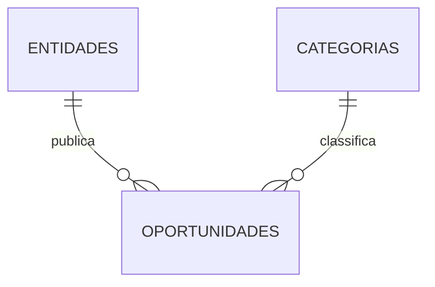

# Women Forward

> **Learn. Build. Lead.**

Women Forward é o projeto de conclusão do Curso de Especialização Tecnológica em Programação e Sistemas de Informação, ofertado pelo IEFP e ministrado no ISLA Gaia. É uma plataforma web que torna cursos, eventos, comunidades e estágios em tecnologia mais fáceis de descobrir, reunindo oportunidades num só lugar.

O projeto nasce de pessoas que conhecem esta procura: querer avançar em tecnologia, procurar referências e oportunidades e, muitas vezes, perder-se entre informação dispersa. Women Forward reúne esses caminhos para que mais mulheres encontrem apoio, visibilidade e possibilidades reais de aprendizagem e carreira.

## Problema

As oportunidades de estudo e progressão profissional em tecnologia estão dispersas por diferentes sites e redes. A procura exige tempo, referências e conhecimento prévio, o que dificulta a construção de percursos claros para quem inicia, muda de área ou pretende avançar.

A plataforma também responde à desigualdade de género em STEM. Segundo a [UNESCO](https://www.unesco.org/en/gender-equality/education/stem), as mulheres representam 35% das pessoas graduadas nestas áreas, proporção que se manteve estável durante uma década. Women Forward procura ampliar o acesso a informação, referências e oportunidades para apoiar autonomia, participação e liderança feminina.

## Comunidade e empoderamento feminino

Avançar em tecnologia torna-se mais possível quando há outras mulheres a partilhar referências, experiências, conhecimento e oportunidades. O sentido de comunidade cria espaço para aprender, ganhar confiança, encontrar novos destaques e apoiar quem vem a seguir.

Women Forward parte dessa ideia: ao tornar oportunidades mais visíveis e aproximar pessoas de comunidades, todas podem avançar com mais apoio. Juntas, somos mais.

## Proposta

- Pesquisa pública de oportunidades com filtros por categoria, tipo, país, cidade e formato.
- Registo de entidades para publicar, editar e remover as suas próprias oportunidades.
- Conteúdo de apoio sobre mulheres em STEM e áreas tecnológicas.
- Direção de marca: **Learn · Build · Lead**.

## Público

Pessoas a partir dos 16 anos, com foco em mulheres que procuram estudar, desenvolver experiência e avançar em áreas STEM, especialmente IT. A plataforma também serve entidades que divulgam oportunidades de aprendizagem, comunidade e carreira.

## Funcionalidades

| Área | Entrega |
| --- | --- |
| Pesquisa | Filtros por texto, categoria, tipo, país, cidade e formato |
| Categorias | Web, Dados & IA, Jogos, Cibersegurança e Carreira & Liderança |
| Oportunidades | Cursos, eventos, comunidades e estágios |
| Entidades | Registo, autenticação e gestão das próprias oportunidades |
| Privacidade | Consentimento explícito e informação sobre o tratamento de dados |
| Interface | Navegação responsiva, flip para leitura dos cards, parallax nas imagens editoriais e botão para voltar ao topo |

## Modelo de dados



Cada oportunidade pertence a uma entidade e a uma categoria. Não existe uma relação direta entre entidades e categorias.

## Tecnologias

- HTML5, CSS3 e JavaScript
- PHP 8.2+ com PDO
- MySQL ou MariaDB
- phpMyAdmin ou cliente MySQL para importar a base de dados

## Estrutura do projeto

```text
config/                 Configuração da ligação à base de dados
database/base_dados.sql Estrutura e dados de exemplo
includes/               Componentes reutilizáveis e funções de apoio
public/                 Páginas acessíveis no navegador
public/assets/          Folhas de estilo, JavaScript, imagens e logótipos
```

## Executar localmente

### Requisitos

| Componente | Requisito |
| --- | --- |
| PHP | PHP 8.2 ou superior, com `pdo_mysql` ativo |
| Base de dados | MySQL ou MariaDB na porta `3306` |
| Servidor local | Servidor embutido do PHP ou Apache incluído no XAMPP |

### Configuração

1. Inicie o MySQL ou MariaDB.
2. Importe [`database/base_dados.sql`](database/base_dados.sql) pelo phpMyAdmin ou no terminal:

   ```bash
   mysql -u root -p < database/base_dados.sql
   ```

   > O script recria a base de dados `womenforward`. Não o execute sobre dados que pretende manter.

3. Confirme os dados de ligação em [`config/db.php`](config/db.php). A configuração incluída usa `localhost`, base `womenforward`, utilizador `root` e palavra-passe vazia.
4. Na raiz do repositório, inicie o servidor:

   ```bash
   php -S 127.0.0.1:8000 -t public
   ```

5. Abra [http://127.0.0.1:8000](http://127.0.0.1:8000) no navegador.

### Conta de demonstração

| Email | Palavra-passe |
| --- | --- |
| `womenforward@demo.test` | `Demo1234` |

## Equipa

| Pessoa | Área de trabalho |
| --- | --- |
| Beatriz Neves | CRUD, pesquisa, filtros e validação |
| Marina Oliveira | Interface, navegabilidade, JavaScript, páginas, formulários e acessibilidade |
| Paulo Primo | Base de dados, autenticação, sessões e controlo de acesso |

## Estado do projeto

Projeto académico em desenvolvimento. As oportunidades apresentadas são divulgadas pelas entidades responsáveis; antes de participar, confirme sempre os detalhes, requisitos e disponibilidade na fonte oficial.
